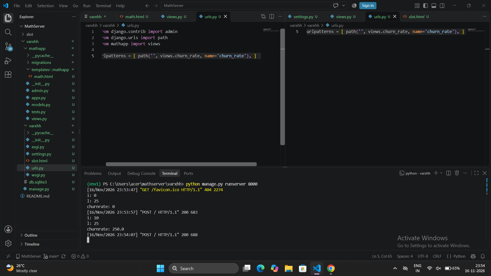

# Ex.03 Design a Website for Server Side Processing
## Date:16/11/2026

## AIM:
To create a web page to calculate Churn Rate using server-side scripts.

## FORMULA:
Churn Rate = (CustLost / InitCust) * 100
<br> InitCust --> Initial Customers Count
<br> CustLost --> Customers Lost Count

## DESIGN STEPS:

### Step 1:
Clone the repository from GitHub.

### Step 2:
Create Django Admin project.

### Step 3:
Create a New App under the Django Admin project.

### Step 4:
Create a HTML file to implement form based input and output.

### Step 5:
Create python programs for views and urls to perform server side processing.

### Step 6:
Receive input values from the form using request.POST.get().

### Step 7:
Calculate the Result using the given formula.

### Step 8:
Display the calculated result in the server console.

### Step 9:
Render the result to the HTML template.

### Step 10:
Publish the website in Localhost.

## PROGRAM:
```
math.html
<html>
<head>
    <title>Math Server</title>
</head>
<body>

    <form method="POST">
        

        <label>Customers Lost:</label>
        <input type="number" name="lost" value="{{l}}" min="0" required>
        <br><br>

        <label>Initial Customers:</label>
        <input type="number" name="initial" value="{{i}}" min="0" required>
        <br><br>

        <input type="submit" value="Calculate">
        <br><br>

        <label>Churn Rate:</label>
        <input type="number" value="{{churnrate}}" readonly>
        <br><br>

    </form>

</body>
</html>

views.py

from django.shortcuts import render

def churn_rate(request):
    i = 0
    l = 0
    churnrate = 0

    if request.method == 'POST':
        i = int(request.POST.get('initial', 0))
        l = int(request.POST.get('lost', 0))

        if i > 0:
            churnrate = (l / i) * 100
    print("i:", i)    
    print("l:" ,l)    
    print("churnrate:",churnrate)
    return render(request, 'mathapp/math.html', {
        'i': i,
        'l': l,
        'churnrate': churnrate
    })

urls.py

from django.contrib import admin
from django.urls import path
from mathapp import views

urlpatterns = [ path('', views.churn_rate, name='churn_rate'), ]
       
```

## OUTPUT - SERVER SIDE:


## OUTPUT - WEBPAGE:


## RESULT:
The the web page to calculate Churn Rate using server-side scripts is created successfully.
